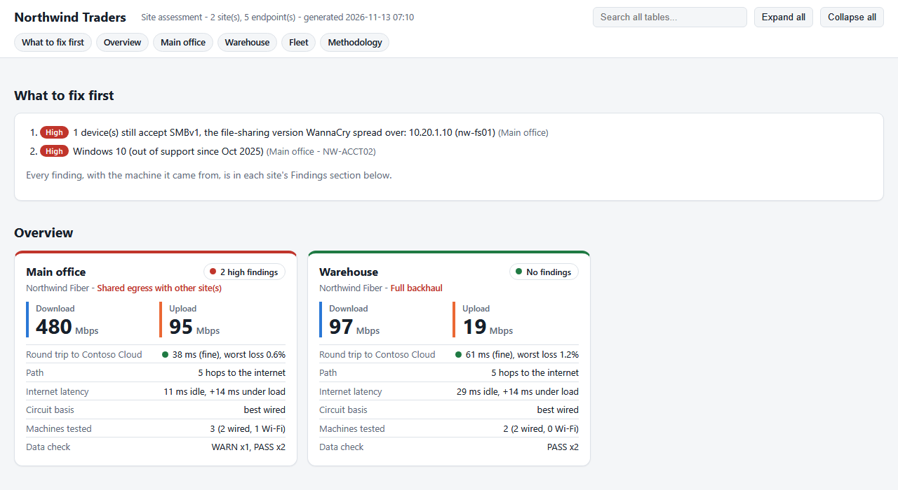

# Site Assessment

**Run one PowerShell script on a Windows PC at a client site and find out how its network really behaves: where the traffic leaves, how fast the circuit is, how the hosted desktop feels, and what is on the desk. Merge the runs from every office into one report.**

[](https://github.com/ZachGSnow/site-assessment/actions/workflows/ci.yml)
[](LICENSE)



## Why

"The remote desktop is slow" can mean a tired PC, bad Wi-Fi, a saturated circuit, a firewall that sends everything through another office, or a provider three states away. Finding out usually means a site visit, a speed test on someone's phone and a guess. This collector measures it all from the PC the user actually works on, in about five minutes, without installing anything. Then it says what the evidence adds up to, and how sure it is.

## Features

- **Traffic design verdict** for every machine: local breakout, split tunnel (remote desktop over a tunnel, internet local) or full backhaul. It's scored from traceroutes, path MTU, DNS servers, the egress network, remote desktop paths and VPN routes, and every signal is listed as evidence.
- **Circuit and path:** download and upload with provider failover (Cloudflare, then M-Lab, then Vultr), bufferbloat (latency under load), a 3-minute loss and jitter series, traceroutes, carrier-grade NAT and double NAT detection, and who owns the public address.
- **Hosted desktop profiles:** tell it which service the users work in (plain RDP, Azure Virtual Desktop, Windows 365, Citrix Cloud, or your own). It finds the client app, the hosts it talks to, and the round trip that matters, graded against Microsoft's Azure Virtual Desktop guidance.
- **The PC itself:** hardware age, Windows version, TPM, BitLocker, disk health, RAM and CPU pressure during the run, Wi-Fi signal and drops, docks, monitors and peripherals, installed security and management tools, patch state, RDP disconnects and client crashes from the event logs.
- **Findings, not just data:** each run ends with findings marked Confirmed, Likely or Possible, a data check that retries anything that failed, and a summary on the clipboard.
- **Optional network discovery** (`-Discovery`, off by default): subnet sweep, the same sweep and identification on other subnets you list or pick (across routing or a site tunnel, MAC addresses from NetBIOS), vendor and multicast discovery, read-only SNMP, printer and camera models, gateway admin ports and UPnP mappings. No logon is attempted and no default passwords are tried.
- **As admin on a wired PC:** a passive listen on the wire for the switch model and port (LLDP/CDP), spanning tree, VLAN tags and DHCP servers. Nothing is sent.
- **Merge and report:** one self-contained HTML report and a set of CSVs across every site and machine. It finds sites that share an egress address, warns when two bandwidth tests overlapped, and spots a test laptop carried from site to site so its own hardware does not pollute the client's figures.
- Runs in **Windows PowerShell 5.1** (paste into ISE and press F5) or PowerShell 7, as a standard user. Admin adds the checks that need it.

## Quick start

On the PC you want to assess (or over your remote support tool, in the user's own session):

1. Open PowerShell ISE. Run it as administrator if you can: that adds TPM, BitLocker, disk health and the switch port.
2. Paste [`Collect-SiteAssessment.ps1`](Collect-SiteAssessment.ps1) into a new tab and press F5. Type the site name when asked.
3. About five minutes later, collect the zip from `C:\Users\Public\Documents\SiteAssessment\`.

Or from a prompt:

```powershell
.\Collect-SiteAssessment.ps1 -SiteName 'Main office'
.\Collect-SiteAssessment.ps1 -SiteName 'Main office' -HostedDesktop AzureVirtualDesktop
.\Collect-SiteAssessment.ps1 -SiteName 'Main office' -Discovery     # only with the client's approval
```

Then, with all the zips in one folder:

```powershell
.\Merge-SiteAssessment.ps1 -Path C:\Assessments\Contoso -ClientName 'Contoso'
```

Open `C:\Assessments\Contoso\_merged\Report.html`. One machine is a complete answer for that machine. Two per site (one wired, one Wi-Fi) let the report confirm the site's verdict and separate the circuit from the desk. [FieldChecklist.md](FieldChecklist.md) covers what to ask before the visit, how to run it, and what to photograph in the closet.

## Configuration

Settings live in the CONFIG block at the top of the collector, so it still works as a single pasted file. For per-client settings, copy [`site-assessment.config.example.psd1`](site-assessment.config.example.psd1), edit it, and pass it with `-ConfigPath`. Your copies are git-ignored.

| Setting | Default | What it does |
|---|---|---|
| `-Discovery` / `$EnableDiscovery` | off | Turns on active discovery of other devices on the network. Each check also has its own `$Enable...` switch |
| `-HostedDesktop` / `$HostedDesktopName` | `RDP` | Built-in profile: `RDP`, `AzureVirtualDesktop`, `Windows365`, `CitrixCloud` |
| `$HostedDesktopProfile` | none | Your own profile: `Name`, `HostPattern`, `AppPattern`, `Targets`, `ProviderAsn` (see the example file) |
| `$ExtraTargets` | none | More hosts to test on every machine, `host` or `host:port` |
| `$SiteList` | none | A numbered site menu, so every machine at a site uses the same name |
| `$SiteSubnets`, `$TunnelServers` | none | Office subnets and servers across a tunnel, for discovery and the findings. With `-Discovery`, `$SiteSubnets` are swept too |
| `$ScanSubnets` | none | Other subnets to sweep with `-Discovery`: `'10.10.2'` (a /24) or `'10.10.8.0/23'` (/22 to /30). The subnets this PC already knows about are listed at the prompt, and none of them is swept unless you pick it. At most `$RemoteSweepMaxSubnets` (8) per run |
| `$VoiceTargets` | `1.1.1.1` | Call-pace sample targets; add the phone system |
| `$BandwidthProviders` | Cloudflare, M-Lab, Vultr | Tried in order per direction |
| `$PingCount` | 180 | Samples in the loss and latency series, one per second |
| `$OutputRoot` | Public Documents | Where runs are written (local, not synced to OneDrive) |

Merge options: `-NoEnrich` makes no network requests; `-TestDevice <host or serial>` names a visiting laptop; `-SiteMap @{ 'typo' = 'Name' }` fixes site names after the fact; `-TargetHint <regex>` adds remote desktop targets to treat as the hosted desktop (use it for runs that do not record a hosted desktop profile).

## Your data and privacy

The collector reads, and writes to the run folder: host name, signed-in user name, group memberships, installed software, printers, mapped drives, Wi-Fi networks, RDP history, event log summaries and the network details above. It does **not** collect passwords, saved credentials, Wi-Fi keys, BitLocker recovery keys, browser data or file contents; `.rdp` files are read for connection settings only, with password and signature lines skipped. Everything is plain text (JSON, CSV, HTML) in a local folder, and it is client data: store and delete it the way your contracts say.

What leaves the PC, and to whom:

| Sent to | What | When |
|---|---|---|
| Cloudflare | Your public IP (trace, speed test) | Always |
| M-Lab | Your public IP; M-Lab publishes every test in its open dataset | Only when Cloudflare's speed test fails |
| Vultr | A download of a public test file | Only when Cloudflare and M-Lab fail |
| ipinfo.io, rdap.org | Your public IP | `$EnableIpInfo`, `$EnableOwnerLookup` |
| api.macvendors.com | MAC vendor prefixes only (first half of the address) | `$EnableOuiLookup` |
| Microsoft 365, public STUN and NTP servers, portquiz.net | Connection tests | `$EnableCloudCheck`, `$EnableOutboundCheck` |

The merge sends only public IP addresses (to Team Cymru, the RDAP registries and Shodan's InternetDB) and downloads the IEEE MAC list once. `-NoEnrich` turns all of it off. Deleting a run folder is an ordinary delete, not a secure erase.

## How it works

```
Collect-SiteAssessment.ps1  (one run per PC, ~5 minutes)
  |
  +-- connection check: adapter, link speed, address, VPN, virtual machine
  +-- remote desktop footprint -> the hosts to measure (profile targets first)
  +-- background: traceroutes, 180-sample ping and TCP series
  +-- inventory: machine, identity, software, peripherals, Wi-Fi, event logs, patching
  +-- egress, path MTU, bandwidth (Cloudflare > M-Lab > Vultr), bufferbloat
  +-- [ -Discovery ] gateway, sweep, other subnets (listed or picked), vendor/multicast
  |                 discovery, SNMP, IPP, RTSP, UPnP
  +-- traffic design verdict + findings + data check (retries what failed)
  v
SITE_HOST_yyyyMMdd-HHmm.zip  (assessment.json, summary.txt, traceroutes, transcript)
  |
  v
Merge-SiteAssessment.ps1  (all zips for a client)
  |
  +-- latest run per site + machine + connection; spot test laptops
  +-- per-site rollup: majority verdict, shared egress, overlapping tests
  +-- optional enrichment: who owns each public IP, MAC vendors, InternetDB
  v
_merged\Report.html + Sites, Endpoints, Findings, Flags, Devices, ... .csv
```

**The verdict.** Each machine scores backhaul signals (the egress network belongs to the hosted desktop provider, a client VPN holds the default route, slow private hops before the ISP, a reduced internet MTU, a distant first public hop that is not just access latency) against split-tunnel signals (the remote desktop host resolves to a private address, its trace crosses a tunnel the internet trace does not, DNS on another private subnet, a lower MTU on the remote desktop path). Carrier-grade NAT and satellite or cellular access latency are recognised and not counted as backhaul. The merge takes the most common verdict per site and turns "local breakout" into "shared egress" when two sites leave through the same public address.

## Testing

```powershell
Install-Module Pester -RequiredVersion 6.2.0 -Scope CurrentUser -Force -SkipPublisherCheck
.\tests\run-tests.ps1
```

The Pester tests run in CI on Windows, in both Windows PowerShell 5.1 and PowerShell 7:

- **Collector:** the CONFIG defaults (discovery off, no client values), `-Discovery`, `-HostedDesktop` and `-ConfigPath` with a custom profile, each built-in profile's host pattern, tracert and ping parsing, trace analysis (tunnel, double NAT, carrier-grade NAT), every traffic design verdict, the bufferbloat grades, and the other-subnet sweep: subnet parsing, the subnets a PC already knows about, which ones get swept (never an inferred one on its own, never the PC's own), and a real sweep over loopback. The collector's functions are loaded from the parsed script, so nothing is collected during tests.
- **Merge:** fictional runs for a two-office company (`tests/Fixtures.ps1`, documentation IP ranges only) are zipped the way the collector writes them and merged with `-NoEnrich`. The tests check the one-machine report, the two-site report, test laptop detection, shared egress, overlapping bandwidth tests, the hosted desktop round trip, and devices swept across routing filed under the site that owns their subnet.

### Used in the field

This tool started as the collector and merge from a real multi-office client assessment (November 2026). Those runs were made with the earlier private versions this release is built from:

- **A visiting laptop at two offices**, wired and as administrator, with every discovery check on: three runs of 8 to 12 minutes each, every one with a PASS data check and no collector errors. They exercised the Cloudflare bandwidth test (two rounds, both directions) and the bufferbloat grade, the traceroutes and 180-sample loss series, the ipinfo and RDAP lookups, the subnet sweep (100+ devices at the larger office), read-only SNMP, vendor and multicast discovery, IPP, RTSP, UPnP, the modem page, DNS timing, the Microsoft 365 and outbound checks, reachability across the site tunnel, the LLDP/CDP wire capture, and the traffic design verdict (split tunnel, high confidence).
- **Three runs on the hosted desktops themselves**, as a standard user, where the verdict reads full backhaul, as expected for a desktop whose internet leaves through the provider.
- **The merge with enrichment on**, over all six runs: Team Cymru, RDAP, reverse DNS, Shodan InternetDB and the IEEE MAC list all answered, and the visiting laptop was detected by its serial number at both offices.

**This release against that field data.** The merge in this repository, run on the same six runs (with `-NoEnrich`, and `-TargetHint` because runs from the earlier versions do not record a hosted desktop profile), produces the same sites, verdicts, circuit figures, hosted desktop round trips and test-laptop detection, and the same number of rows in every CSV, as the merge they were made with. The collector in this repository was run in Windows PowerShell 5.1 (discovery and outside lookups off) and merged into a one-machine report. The built-in Azure Virtual Desktop and Windows 365 hosts were checked against Microsoft's "Required FQDNs and endpoints for Azure Virtual Desktop", and the Citrix Cloud domains against Citrix's connectivity pages (November 2026).

**Not exercised yet:** the M-Lab and Vultr bandwidth fallbacks (Cloudflare never failed in the field), the api.macvendors.com lookup, and the built-in Azure Virtual Desktop, Windows 365 and Citrix Cloud profiles against a live tenant. Non-English Windows is untested: ping and tracert output is parsed in English.

## License

[MIT](LICENSE) (c) Zach Snow
