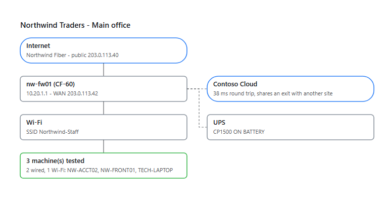

# Site Assessment

**One PowerShell script, run on a Windows PC at a client site, finds out how the network really behaves: where the traffic leaves, how fast the circuit is, whether the hosted desktop can work well, what is on the network and what is risky. A second script merges every office into one report that opens with what to fix first.**

[](https://github.com/ZachGSnow/site-assessment/actions/workflows/ci.yml)
[](LICENSE)


## Why

"The remote desktop is slow" can mean a tired PC, bad Wi-Fi, a saturated circuit, a firewall that sends everything through another office, a NAT that forces the session onto TCP, or a provider three states away. Finding out usually means a site visit, a speed test on someone's phone and a guess. This measures it from the PC the user actually works on, in about five minutes, without installing anything, and says what the evidence adds up to and how sure it is.

## What it finds

**The circuit and the path**
- Download and upload (Cloudflare, falling back to M-Lab, then Vultr), latency under load (bufferbloat), a 3-minute loss and jitter series, traceroutes, path MTU, carrier-grade NAT and double NAT, and who owns the public address.
- A **traffic design verdict** for every machine: local breakout, split tunnel or full backhaul, with every signal it rests on.
- IPv6: offered or not, and whether it really reaches the internet (a broken IPv6 path slows every first connection).

**The remote desktop**
- Profiles for plain RDP, Azure Virtual Desktop, Windows 365, Citrix Cloud or your own provider: the client app, the hosts it talks to, and the round trip that matters.
- Whether sessions can use **UDP**, the faster transport, or are stuck on TCP: from the RDP client's own history, the client policy, a STUN test of the NAT, and what Microsoft lists as breaking it.

**The PC**
- Hardware age, Windows version, TPM, BitLocker, disk health, memory and CPU pressure during the run, Wi-Fi signal and drops, docks and peripherals, security and management tools, patch state, RDP disconnects and client crashes.

**The network** (with `-Discovery`, off by default)
- A sweep of the local subnet and of the other subnets you list or pick, with names, open ports, web pages, banners, Windows builds and MAC vendors.
- Read-only SNMP: switch ports and PoE, printers and their counters, and from routers their ARP table (MACs on every VLAN), routes and WAN address (the circuit of a site where no machine was run). UPS battery, runtime and load.
- As administrator on a wired PC, a passive listen for the switch and port (LLDP/CDP), VLANs and DHCP servers.

**One finding leads to the next check.** Nothing is a fixed list when the evidence can say better: the phone system named by DHCP or SIP becomes the voice-quality target; the modem behind a double NAT and the firewall's own VPN and admin pages, chosen by its make, get checked; switches that announce a management address are asked over SNMP; servers on other subnets are tested across the tunnel; Active Directory's sites and the gateway's routes feed the subnet list. Devices worth a closer look get one, without signing in: server management controllers (Redfish), VMware hosts (version), QNAP and Synology storage, RD Web and RD Gateway.

**What it flags**
- Network risks: SMBv1, Telnet and FTP, plain-HTTP admin pages, expired certificates, RDP and file sharing open across routing, SNMP on `public`, old SSH servers, Windows and VMware out of support, management controllers on the office network.
- Email domain (public DNS): where mail goes, SPF, DMARC, DKIM, MTA-STS, with weak or missing records flagged.
- Active Directory: a subnet AD does not know, a logon to a domain controller in another site, a site without one.

**The report**
- One self-contained HTML file and a set of CSVs for every site and machine, opening with **what to fix first**: the high and medium findings across all sites, each once, with where it was seen.
- Per site: bandwidth, round trip, latency, the traceroute path, the traffic design, a **site diagram** drawn only from what was found, equipment, routers and UPS, findings and machine detail.
- Across sites: shared exits, overlapping speed tests, and a test laptop carried between sites (its own hardware is kept out of the client's figures).



## Quick start

On the PC you want to assess (or over your remote support tool, in the user's own session):

1. Open PowerShell ISE, as administrator if you can (that adds TPM, BitLocker, disk health and the switch port).
2. Paste [`Collect-SiteAssessment.ps1`](Collect-SiteAssessment.ps1) into a new tab and press F5. Type the site name when asked.
3. About five minutes later, collect the zip from `C:\Users\Public\Documents\SiteAssessment\`.

Or from a prompt:

```powershell
.\Collect-SiteAssessment.ps1 -SiteName 'Main office'
.\Collect-SiteAssessment.ps1 -SiteName 'Main office' -HostedDesktop AzureVirtualDesktop
.\Collect-SiteAssessment.ps1 -SiteName 'Main office' -Discovery     # only on a network you are authorised to assess
```

Then, with every zip in one folder:

```powershell
.\Merge-SiteAssessment.ps1 -Path C:\Assessments\Contoso -ClientName 'Contoso'
```

Open `C:\Assessments\Contoso\_merged\Report.html`. One machine is a complete answer for that machine; two per site (one wired, one Wi-Fi) confirm the site's verdict and separate the circuit from the desk. [FieldChecklist.md](FieldChecklist.md) covers what to ask before a visit, how to run it, and what to photograph in the closet. Runs in Windows PowerShell 5.1 or PowerShell 7, as a standard user.

## Configuration

Settings live in the CONFIG block at the top of the collector, so it still works as one pasted file. For per-client settings, copy [`site-assessment.config.example.psd1`](site-assessment.config.example.psd1), edit it, and pass it with `-ConfigPath` (your copies are git-ignored).

| Setting | Default | What it does |
|---|---|---|
| `-Discovery` / `$EnableDiscovery` | off | Active discovery of other devices on the network. Each check also has its own `$Enable...` switch |
| `-HostedDesktop` / `$HostedDesktopName` | `RDP` | `RDP`, `AzureVirtualDesktop`, `Windows365` or `CitrixCloud` |
| `$HostedDesktopProfile` | none | Your own provider: `Name`, `HostPattern`, `AppPattern`, `Targets`, `ProviderAsn` (see the example file) |
| `$ExtraTargets` | none | More hosts to test on every machine, `host` or `host:port` |
| `$SiteList` | none | A numbered site menu, so every machine at a site uses the same name |
| `$ScanSubnets`, `$SiteSubnets` | none | Other subnets to sweep with `-Discovery` (`'10.10.2'` or `'10.10.8.0/23'`, /22 to /30, at most 8 per run). Subnets the PC already knows about are offered at a prompt; none is swept unless you pick it |
| `$TunnelServers` | none | Servers across a tunnel to test from an office port (servers the PC uses on other subnets are added on their own) |
| `$VoiceTargets` | `1.1.1.1` | Call-quality targets; a phone system found on the network is added with `-Discovery` |
| `$EnableLeadChecks` | on with `-Discovery` | The follow-up checks on what was found |
| `$EnableAdSites`, `$EnableDomainCheck`, `$EnableIpv6Check` | on | Active Directory sites (domain PCs), the email domain in public DNS, IPv6 |
| `$PingCount` | 180 | Samples in the loss and latency series, one per second |

Merge options: `-NoEnrich` makes no network requests; `-TestDevice <host or serial>` names a visiting laptop; `-SiteMap @{ 'typo' = 'Name' }` fixes site names; `-TargetHint <regex>` marks remote desktop targets for runs that recorded no profile.

## Safe by default, and your data

A plain run looks only at the PC and its path to the internet. Everything that talks to other devices on the network needs `-Discovery`, and even then nothing signs in, no default password is tried, and SNMP is read-only. Use discovery only on networks you are authorised to assess.

The run folder holds host names, user names, group memberships, installed software, printers, mapped drives, Wi-Fi networks, RDP history, event log summaries and the network details above, in plain text (JSON, CSV, HTML). It does **not** collect passwords, saved credentials, Wi-Fi keys, BitLocker recovery keys, browser data or file contents; `.rdp` files are read for connection settings only. Treat the output as client data. IPv6 addresses are kept as /64 prefixes only.

What leaves the PC:

| Sent to | What | When |
|---|---|---|
| Cloudflare | The public IP (trace, speed test), also over IPv6 when the PC has it | Always (`$EnableIpv6Check` for IPv6) |
| M-Lab, Vultr | The public IP (M-Lab publishes its tests), a public test download | Only when the Cloudflare speed test fails |
| ipinfo.io, rdap.org | The public IP | `$EnableIpInfo`, `$EnableOwnerLookup` |
| 1.1.1.1 (public DNS) | The client's email domain | `$EnableDomainCheck` |
| api.macvendors.com | MAC vendor prefixes only | `$EnableOuiLookup` |
| Microsoft 365, STUN and NTP servers, portquiz.net | Connection tests | `$EnableCloudCheck`, `$EnableOutboundCheck` |

The merge sends only public IP addresses (Team Cymru, the RDAP registries, Shodan's InternetDB) and downloads the IEEE MAC list once; `-NoEnrich` turns that off.

## How it works

```
Collect-SiteAssessment.ps1   one run per PC, about 5 minutes (10 to 12 with discovery)
  |
  +-- connection check, remote desktop footprint -> the hosts to measure
  +-- background: traceroutes, 180-sample ping and TCP series
  +-- inventory: machine, identity, software, peripherals, Wi-Fi, event logs, AD sites
  +-- egress, IPv6, email domain, path MTU, bandwidth, bufferbloat
  +-- [ -Discovery ] subnets (local, listed, picked), identification, follow-up checks,
  |                  SNMP, printers, cameras, gateway services
  +-- verdict, findings, flags, data check (retries anything critical that failed)
  v
SITE_HOST_yyyyMMdd-HHmm.zip   assessment.json, summary.txt, traceroutes
  |
  v
Merge-SiteAssessment.ps1   every zip for a client
  +-- latest run per site, machine and connection; spot test laptops
  +-- per site: majority verdict, shared exits, overlapping tests, diagram
  +-- optional: who owns each public IP, MAC vendors, what the internet sees
  v
_merged\Report.html, diagrams\*.svg, Sites, Endpoints, Findings, Flags, Devices, ... .csv
```

**The verdict.** Each machine scores backhaul signals (the internet leaves through the hosted desktop provider, a client VPN holds the default route, slow private hops before the ISP, a reduced MTU, a distant first public hop that is not just access latency) against split-tunnel signals (the remote desktop host resolves privately, its path crosses a tunnel the internet path does not, DNS on another private subnet). Carrier-grade NAT and satellite or cellular latency are recognised and not counted as backhaul. The merge takes the most common verdict per site, and two sites leaving through one public address become "shared egress".

## Working on the code

`Collect-SiteAssessment.ps1` is built, not edited: it is used as one file, but kept as small pieces under `src/collector` (`00-header`, `10-config`, `lib/` for every function by area, `run/` for what a run does in order, `99-end`). Edit the pieces, rebuild, and commit both:

```powershell
.\tools\Build-Collector.ps1
```

A test fails when the committed script does not match what the pieces build. `Merge-SiteAssessment.ps1` is a single file.

## Testing

```powershell
Install-Module Pester -RequiredVersion 6.2.0 -Scope CurrentUser -Force -SkipPublisherCheck
.\tests\run-tests.ps1
```

The tests run in CI on Windows, in both Windows PowerShell 5.1 and PowerShell 7. The collector's functions are loaded from the parsed script, so nothing is collected: every verdict and parser, the configuration and profiles, the subnet choices (never an inferred subnet on its own), each lead and follow-up check with HTTP and SNMP mocked, the email, IPv6, AD and remote desktop checks with DNS and the network mocked, every risk rule including what it must leave alone, a real sweep and real pings and traces over loopback, and the build itself. The merge is tested on fictional runs for a two-office company (`tests/Fixtures.ps1`, documentation IP ranges only).

**Used in the field.** The tool comes from a real multi-office client assessment (November 2026), run with the earlier private versions: a visiting laptop at two offices with every discovery check of that time on (Cloudflare bandwidth, traceroutes and loss series, sweeps of 100+ devices, SNMP, vendor and multicast discovery, printers, cameras, the wire capture), runs on the hosted desktops themselves, and the merge with every lookup on. All passed their data checks with no collector errors. This repository's merge, run on those six runs, reproduces their results exactly.

**Checked against real data since:** the collector in this repository on Windows PowerShell 5.1 (passive runs), its .NET pings and traceroutes against `tracert.exe`, the remote desktop UDP verdict (UDP in use, STUN consistent, carrier-grade NAT noted), and the email domain check against real public DNS (which found and fixed two bugs). A full `-Discovery` run on a small network on satellite internet (Wi-Fi, no managed switches or SNMP) exercised the bandwidth test, the local sweep and identification, the gateway and modem checks, SNMP with nothing answering, the other-subnet prompt and sweep, DNS timing, call quality, the Microsoft 365 and outbound checks, IPv6 (not offered) and the merge; it found and fixed a 45-second wait on a gateway without SNMP, two collector "errors" that were normal outcomes, and DNS findings that misread public resolvers. The Azure Virtual Desktop, Windows 365 and Citrix hosts follow Microsoft's and Citrix's published endpoint lists.

**Not yet run against real devices:** router and UPS tables (no device has answered SNMP yet), the follow-up checks (nothing on a network so far has triggered one), a sweep of another subnet that has devices on it, AD sites on a domain PC, and IPv6 on a network that has it. They are covered by tests on fictional data until then. The M-Lab and Vultr speed-test fallbacks and the MAC vendor lookup have never been needed in a real run (Cloudflare has always answered).

## License

[MIT](LICENSE) (c) Zach Snow
